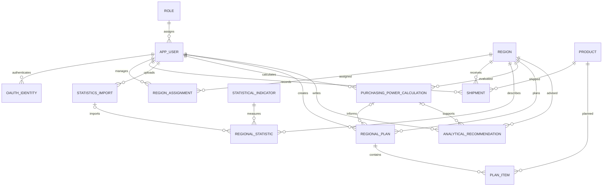

# Модель данных

Основа — таблица 2.1 пояснительной записки и §5 PROJECT_CONTEXT_FOR_CODEX. Имена Java-классов сохраняют предметные термины, SQL использует множественное число и `snake_case`.

## Сущности

| Java-класс | Таблица | Основные атрибуты и связи |
| --- | --- | --- |
| `Role` | `roles` | Уникальный код, название; одна роль у многих пользователей |
| `AppUser` | `app_users` | Роль, уникальный логин, email, BCrypt-хеш для парольного входа, ФИО, активность, версия сессии, дата создания |
| `Region` | `regions` | Уникальные код/название, активность; шесть областей Беларуси и город Минск |
| `Product` | `products` | Уникальный SKU, название, категория, единица, характеристики, текущая цена и её дата, активность |
| `RegionAssignment` | `region_assignments` | Регион, менеджер, начало и необязательное окончание назначения |
| `Shipment` | `shipments` | Товар, регион, автор, дата, количество, историческая цена, вычисленная сумма, уникальный необязательный номер документа |
| `StatisticalIndicator` | `statistical_indicators` | Уникальный код, название, единица, периодичность |
| `StatisticsImport` | `statistics_imports` | Файл, источник, пользователь, дата, статус и счётчики строк |
| `RegionalStatistic` | `regional_statistics` | Регион, показатель, период, значение, необязательная ссылка на импорт и источник, дата обновления |
| `PurchasingPowerCalculation` | `purchasing_power_calculations` | Регион, период, версия метода, индекс, автор, дата, примечание |
| `RegionalPlan` | `regional_plans` | Регион, период, статус, бюджет, цель, расчёт-основание, автор, утверждающий, даты и замечания |
| `PlanItem` | `plan_items` | План, товар, количество, историческая цена, вычисленная сумма |
| `AnalyticalRecommendation` | `analytical_recommendations` | Регион, необязательный расчёт-основание, автор, дата, текст |
| `OAuthIdentity` | `oauth_identities` | Дополнительная сущность: пользователь, провайдер, постоянный идентификатор subject |

Каждая таблица имеет простой ключ `BIGINT AUTO_INCREMENT`. Служебная таблица истории Flyway не является предметной сущностью.

## Связи

Дополнительно `RegionalPlan.approvedByUser` ссылается на утверждающего пользователя и допускает отсутствие до утверждения. Отсутствие двунаправленных коллекций в Java не отменяет внешние ключи БД.

## Целостность и точность

- Уникальны коды справочников, логин/email пользователя и пара provider/subject.
- Для статистики уникальна комбинация региона, показателя и границ периода.
- Для плана уникальна комбинация региона и периода, для позиции — плана и товара.
- Даты регионального назначения включительны. Сервер проверяет порядок дат и запрещает пересечение периодов для одного менеджера и региона.
- Количество отгрузки и плановой позиции положительно, цены неотрицательны; денежные значения не используют `double`.
- `shipments.total_amount = ROUND(quantity * unit_price, 2)` и `plan_items.planned_amount = ROUND(planned_quantity * planned_unit_price, 2)` вычисляет MySQL. Они отображаются JPA как поля только для чтения.
- `ON DELETE RESTRICT` сохраняет связанную историю. Деактивация пользователя, региона или товара предпочтительнее физического удаления.
- Статусы плана: `DRAFT`, `IN_REVIEW`, `REVISION`, `APPROVED`. Enum и CHECK задают допустимый набор, но переходы между статусами будет контролировать бизнес-сервис следующего этапа.
- `RegionalPlan.version` подготовлен для оптимистической блокировки конкурентных изменений.

Точные имена колонок, размеры и CHECK-ограничения задаются SQL-миграциями `backend/src/main/resources/db/migration/`; они являются исполняемым источником схемы.

## Нормализация

Справочники ролей, регионов, товаров и показателей выделены отдельно. Отгрузки, значения статистики, планы и их позиции связаны по ключам и не дублируют названия справочников. Исторические цены намеренно фиксируются в фактах и планах, чтобы изменение цены каталога не меняло прошлую выручку. Вычисляемые суммы — обоснованная производная величина, защищённая вычисляемым столбцом, а не независимо редактируемый атрибут.

Роли, регионы и определения статистических показателей входят в начальные справочники. Реальные значения Белстата и вымышленные коммерческие факты не смешиваются с ними.
